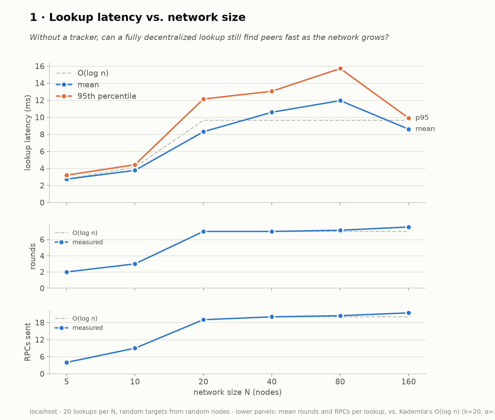
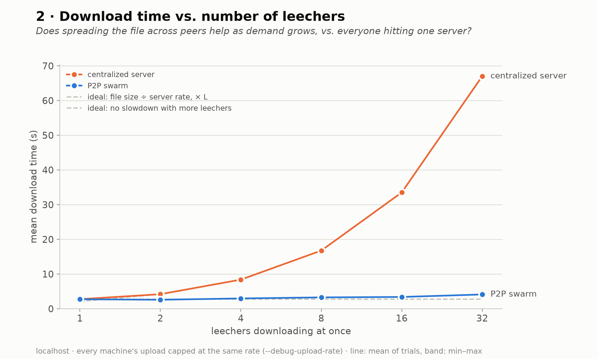
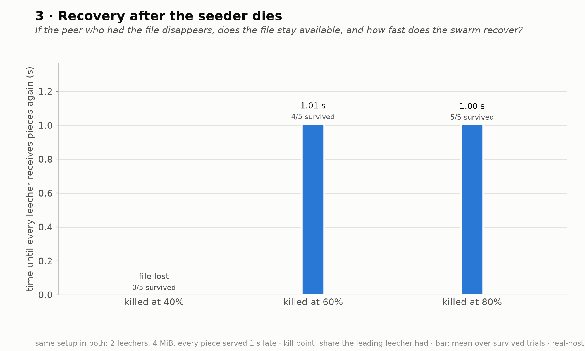
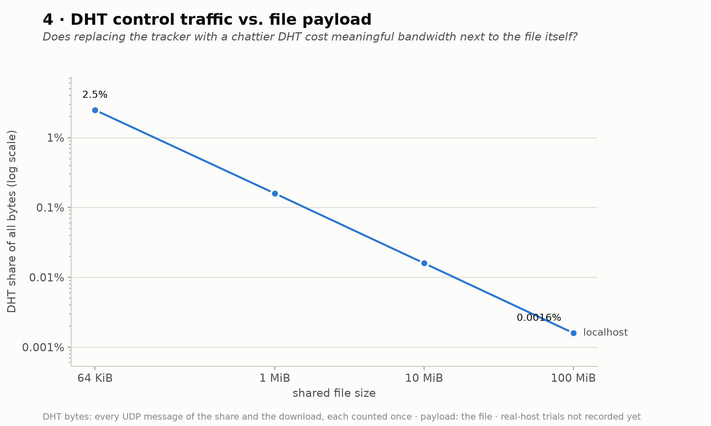
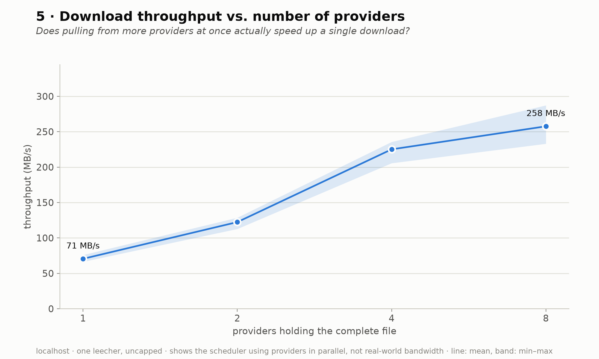
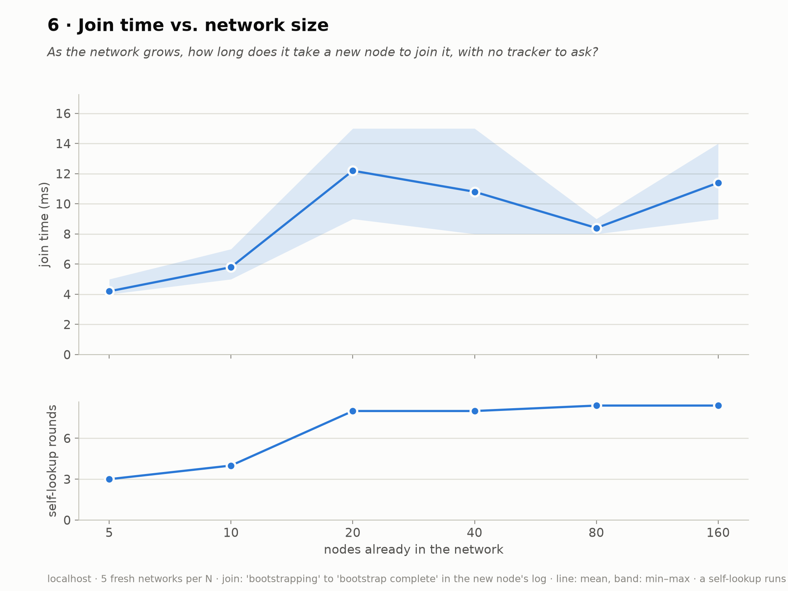

# 10. Performance graphs

Prerequisite: [05-iterative-parallel-lookup.md](05-iterative-parallel-lookup.md),
[08-swarming.md](08-swarming.md) and [09-multi-device.md](09-multi-device.md).

Six graphs, each answering one question about this design. Graphs 1–4
are the four the project set out to draw (README, "Where the project
stands"). Graphs 5 and 6 are extra: they measure two features this
branch's own work touched that the first four never exercise, provider
fan-in (swarming) and joining. How to run every experiment:
[eval/README.md](../eval/README.md). The numbers below are real runs on
one laptop; the real-laptop halves of graphs 3 and 4 are recorded by
hand with [`eval/scripts/eval-field-tests.html`](../eval/scripts/eval-field-tests.html).

## Two claims, three graphs each

This project removes two things a BitTorrent-style system usually has:
a **tracker** (who has file X?) and a **central server** (the file
itself). Each graph defends one of the two:

| Claim | Graphs | The risk it checks |
|---|---|---|
| **Trackerless works:** a DHT can replace the tracker | 1, 4, 6 | asking many peers in several hops could be slower, or chattier, than asking one tracker once |
| **P2P transfer works:** peers can replace the server | 2, 3, 5 | true even for a swarm that has a tracker; it's about where the bytes come from |

A second, unrelated split is *where* each graph runs:

| Environment | Graphs | Why |
|---|---|---|
| localhost only | 1, 2, 5, 6 | they need tens to hundreds of nodes, and what they measure (lookup rounds, scheduling, a modeled uplink) doesn't depend on a real network |
| localhost **and** 3 laptops | 3, 4 | they need only 2–3 nodes, and a real network can change the answer. Both environments run the identical setup, so the network is the only difference between the two series |

## At a glance

| # | Question | Result on localhost |
|---|---|---|
| 1 | Can a decentralized lookup stay fast as the network grows? | ~20 RPCs in ~7 rounds, ~10 ms, from 20 nodes to 160: the cost stops growing once N > k |
| 2 | Do peers help as demand grows, vs. one server? | P2P: 2.7s→4.1s from 1→32 leechers; centralized: 2.8s→67s |
| 3 | Does the file survive its seeder, and how fast is recovery? | killed at 40%: 0/5 survived; 60%: 4/5; 80%: 5/5 — recovery ~1.0s whenever it survived |
| 4 | Is the DHT's chatter significant next to the file? | a constant 1668 bytes per share + download: 2.5% of a 64 KiB file, 0.0016% of a 100 MiB one |
| 5 | Do more providers make one download faster? | 70 MB/s from 1 provider, 258 MB/s from 8 |
| 6 | How costly is joining as the network grows? | ~4 ms with 5 nodes, ~10 ms from 20 nodes on, the same plateau as graph 1 |

## Fixed parameters

| | Value |
|---|---|
| Network sizes (graphs 1, 6) | N = 5, 10, 20, 40, 80, 160 |
| Leechers (graph 2) | L = 1, 2, 4, 8, 16, 32 |
| Providers (graph 5) | P = 1, 2, 4, 8 (stays below the 16-per-key provider-record cap, below) |
| File sizes (graph 4) | 64 KiB, 1 MiB, 10 MiB, 100 MiB |
| Seeder killed at (graph 3) | 40%, 60%, 80% of the leading leecher's pieces (calibrated, below) |
| Test file (graphs 2, 5) | 20 MiB of random bytes (320 pieces) |
| Graph 3's setup, both environments | 1 seeder + 2 leechers, a 4 MiB file (64 pieces), `--debug-serve-delay 1s` on every node, `--max-inflight 1`, the second leecher starts at `have=8`, kill at 40/60/80% (`have=26/39/52`) — calibrated, not guessed: with no kill at all, the two leechers' pieces together cover the whole file by the time the first is ~60% done, so this spread reliably loses, sits right at the edge, and reliably survives, instead of landing on one side |
| Graph 4's setup, both environments | 1 seeder + 1 leecher, no debug flags |
| Trials | 5 per point on localhost, 3 per point on laptops (they're run by hand); graph 1: 20 lookups per N |
| Protocol | the defaults: k = 20, α = 3, 64 KiB pieces, 2 s RPC timeout |
| Graph 2's uplink | 10 MB/s per node and for the server (`--debug-upload-rate`, below) |

## Graph 1: lookup latency vs. network size

**Question:** without a tracker to ask, can a fully decentralized lookup
still find peers fast as the network grows?

**Setup** (`eval/scripts/lookup_latency.sh`): one network grows on
localhost, every node joining through a random running one (as in
`scripts/demo-big-network.sh`). At each size, 20 lookups for random
targets from random nodes go through `POST /api/lookup`. Latency is
curl's time for that request; `rounds` and `rpcs_sent` come from its
response (`LookupResult`, `lookup.go`).

**Result:** cost grows only until N reaches k = 20, then stops: from 20
to 160 nodes a lookup takes ~20 RPCs in ~7 rounds and 8–12 ms. No RPC
failed in any of the 120 lookups. The rounds/RPCs panels also plot
**expected = ⌈min(N−1, k)/α⌉ rounds, min(N−1, k) RPCs** (dashed, derived
from k and α, not fitted to the data) and the measured line sits on top
of it almost exactly.

**Reading it:** a lookup ends when it has heard from the k closest nodes
it found, so it costs about k RPCs, α = 3 at a time (20 / 3 ≈ 7
rounds), whatever the network's size. Hops grow with log N, but with
k = 20 that only shows on networks far bigger than 160 — there isn't a
clean "O(log N)" curve to plot here, because this implementation's
routing table is a flat array of 160 buckets, not the paper's splitting
tree (a SIMPLIFICATION, [ARCHITECTURE.md](ARCHITECTURE.md)); real O(log N)
hop counts would only appear on networks big enough that nodes stop
fitting in the top few buckets, far past 160. That is the claim: an 8×
bigger network costs the same lookup. Latency wobbles (8.3 → 12.0 → 8.6
ms) while rounds and RPCs track the formula almost exactly: that's
process scheduling on one laptop adding noise to latency, not to the
protocol's own counts. On localhost every peer is equally near, so this
measures the algorithm, not network distance (FAQ, "Is XOR distance
related to latency").

## Graph 2: download time vs. leechers, P2P vs. centralized

**Question:** does spreading the file across peers help as demand grows,
compared with everyone downloading from one server?

**Setup** (`eval/scripts/download_time.sh`): for each L, a fresh network
of one seeder and L leechers; all L fetch a 20 MiB file at once, and a
trial's time is their mean `duration_ms`. Then L `curl`s download the
same file at once from one plain HTTP server (`eval/fileserver`).

**The uplink cap.** Loopback has no bandwidth limit, so without one a
localhost "server" feeds any number of clients at memory speed. Run
uncapped, the centralized server won ~10× (0.03 s vs. 0.26 s at L = 1),
because the bottleneck P2P removes, one server uplink shared by every
client, never appeared, while P2P still paid per-piece hashing and RPCs.
So every node runs with the DEBUG ONLY `--debug-upload-rate 10000000`
(10 MB/s, 80 Mbit/s) and the server gets the same cap: same hardware,
different architecture. Downloads are uncapped. The cap is one shared
pacing timeline per node (`uplink` in `internal/transfer/server.go`;
`eval/fileserver` has an identical copy), so 32 connections share 10
MB/s rather than getting 10 MB/s each.

**Result:**

| L | 1 | 2 | 4 | 8 | 16 | 32 |
|---|---|---|---|---|---|---|
| P2P swarm | 2.7s | 2.6s | 3.0s | 3.3s | 3.4s | 4.1s |
| centralized server | 2.8s | 4.2s | 8.4s | 16.8s | 33.5s | 67.0s |

Centralized time grows almost exactly linearly: (file size ÷ server rate) × L,
2.1 s per extra leecher, matching the configured 20 MiB ÷ 10 MB/s exactly
from L = 2 on (the L = 1 point sits a little above that line — a one-time
connection cost that doesn't repeat per leecher, so it doesn't fit a line
through the origin). P2P barely moves: 2.7 s → 4.1 s across the whole 32×
range.

**Reading it:** the server's one uplink is split L ways, so its time
grows linearly. Every leecher that holds pieces serves them too (partial
seeding, [08](08-swarming.md)), so the swarm's total upload grows with
L too, just far more slowly — the file keeps spreading across more
machines, each with its own uplink, instead of staying behind one. On a
real network more would differ (latency, Wi-Fi contention), but the
mechanism is this one.

## Graph 3: recovery after the seeder dies

**Question:** if the peer that had the file disappears, does the file
stay available, and how fast do the others recover?

**Setup** (`eval/scripts/recovery_time.sh`, and test 1 of the
checklist on 3 laptops; the same setup in both): a seeder and two
leechers share a 4 MiB file (64 pieces), every node sending each piece
1 s late (`--debug-serve-delay`, as in field test 4, so a person can
stop the seeder at a chosen moment), each leecher fetching one piece at
a time. The second leecher starts when the first has 8 pieces. When the
first has 40%, 60% or 80% of the pieces (`have=26`, `39`, `52`), the
seeder is stopped (SIGTERM on localhost, Ctrl+C on a laptop: both log
`shutting down` and close its sockets).

These kill points aren't an arbitrary split: run the same setup with no
kill at all, and the two leechers' pieces together cover the whole file
by the time the first is only ~60% done (measured directly, three
localhost trials: 59–61%). So 40% should reliably lose the file, 60%
sits right at that boundary, and 80% should reliably survive it — a
deliberate spread across the actual transition, not three points that
happen to land on the same side of it.

- **survived**: every leecher finished with a byte-identical copy.
- **recovery**: for each leecher, from its own `provider failed` line
  for the seeder (the moment it noticed) to its next `piece received`;
  the slowest leecher's value. Both times come from one machine's log,
  following [09](09-multi-device.md)'s rule never to compare two
  machines' clocks. Stopping a process closes its sockets at once, so
  noticing is immediate: on localhost the leechers logged it within
  1 ms of the seeder's `shutting down`.

**Result:**

| Killed at | Survived | Recovery (mean of survived trials) |
|---|---|---|
| 40% | 0/5 | — (file lost every time) |
| 60% | 4/5 | 1.007 s |
| 80% | 5/5 | 1.004 s |

60% lands right on the boundary we calibrated for: it's the one kill
point where trials actually split, 4 survived and 1 didn't — the real
transition isn't a hard cliff at a single piece count, it has a narrow
window where a slightly different interleaving of requests tips the
outcome either way. Every trial that did survive recovered in ~1.0 s,
whether killed at 60% or 80%.

**Reading it:** the file survives exactly when the leechers *together*
hold every piece at the moment the seeder goes. Rarest-first spreads
the pieces, so with two leechers that happens around 60% of the first
leecher's own progress — well before it's done, but not as early as
40%. Once it has, recovery is about one piece's time, and every piece
takes the 1 s serve delay, so read the bars as "1 s delay + what the
network adds": the two series share that delay, and the gap between
them is the network. This is resilience from the swarm (several
holders), not from the DHT healing itself: this branch has no record
republishing yet.

## Graph 4: DHT control traffic vs. file payload

**Question:** does replacing the tracker with a chattier DHT (multi-hop
lookups, re-discovery every second while downloading) cost meaningful
bandwidth next to the file?

**Setup** (`eval/scripts/bytes_overhead.sh`, and test 2 of the checklist
on 2 laptops): a seeder and a leecher; the seeder shares a file, the
leecher downloads it.

- **control bytes**: the new `bytes=` attribute of every `rpc received`
  log line ([NODE-API.md](NODE-API.md)), summed over both nodes. Every
  UDP message is received exactly once, so that's all DHT traffic, each
  message counted once; logging the send side too would count each
  twice. Only the share and download count, not the leecher's join:
  on the seeder from its first `rpc sent` (it only answers during the
  join), on the leecher after `bootstrap complete`.
- **payload bytes**: the leecher's `download complete` `bytes=`, the file.

**Result:** 1668 bytes of DHT traffic in every trial and every size (834
received by each node): 2.5% of a 64 KiB file, 0.16% of 1 MiB, 0.016%
of 10 MiB, 0.0016% of 100 MiB.

**Reading it:** discovery is a fixed cost (one lookup and one STORE to
publish, one FIND_VALUE to find), so it vanishes as files grow. It isn't
quite fixed in general: a running download re-asks the DHT every second
([08](08-swarming.md)), so a download lasting t seconds adds about t
small lookups. On localhost even 100 MiB arrives in under a second, so
none fire; over Wi-Fi they will, which is what the laptop series shows.
Two limits of the number: messages are JSON, which inflates it (README,
simplifications); and it can't show IP fragmentation. `bytes=` is the
UDP payload, the same on any MTU. Fragments add IP headers below it, so
fragmentation would only show as failed RPCs.

## Graph 5: download throughput vs. number of providers

**Question:** does pulling from more providers at once speed up a
single download? (Graph 2 varies the leechers; this varies the
providers.)

**Setup** (`eval/scripts/throughput_providers.sh`): P providers all
share the same 20 MiB file (same content, same key: P complete copies),
one leecher fetches it with `--max-inflight P`, no upload cap.
Throughput = file size ÷ `duration_ms`; the response's `pieces_from`
confirms every provider sent pieces.

P stays below 16 on purpose: a key can hold at most `maxValuesPerKey` =
16 values (`internal/kademlia/store.go`) before the oldest are silently
dropped, so a file's provider-record list is capped at 16 regardless of
how many nodes actually share it — a leecher can never discover a 17th.
Checked directly while building this graph: sweeping P up to 160 (the
same range as graphs 1 and 6) showed exactly this — at P=20 and P=40,
only 16 of the providers ever contributed a piece, and throughput
stopped climbing past that point. Real limit, not measurement noise,
but it means a bigger sweep here would plot the cap, not the scheduler,
so P is kept inside it.

**Result:** 70 MB/s from 1 provider, 122 from 2, 225 from 4, 258 from 8
(0.30 s down to 0.08 s for the file).

**Reading it:** a download keeps one request outstanding per provider
([08](08-swarming.md), a SIMPLIFICATION), so one provider is limited by
one round trip per piece; more providers mean more requests in flight.
Gains flatten (3.7× from 8× the providers), most likely because the
leecher itself, hashing and writing every piece, becomes the bottleneck
(not measured separately). On localhost
all providers share one machine, so this shows the scheduler using
providers in parallel, not real bandwidth adding up; graph 2 is the one
that models uplinks.

## Graph 6: join time vs. network size

**Question:** as the network grows, how long does a new node take to
join it, with no tracker to ask?

**Setup** (`eval/scripts/bootstrap_time.sh`): five times, a fresh
network grows on localhost as in graph 1; for each N, the node that
joins a network of exactly N nodes is measured: from its own
`bootstrapping` log line to `bootstrap complete` (so process and API
start-up don't count), plus that line's `self_lookup_rounds`.

**Result:** 4.2 ms with 5 nodes, 5.8 ms with 10, then 8–12 ms from 20
to 160, at ~8 self-lookup rounds and ~21 RPCs.

**Reading it:** a join is a PING plus a lookup of the joiner's own ID
([04](04-bootstrap-and-join.md)), so it plateaus exactly like graph 1,
one round more because the self-lookup starts from a single contact.
Joining a 160-node network costs what joining a 20-node one does.

## How the numbers are taken

| What | Where | Note |
|---|---|---|
| Lookup and fetch results | `POST /api/lookup`, `/api/fetch` ([NODE-API.md](NODE-API.md)) | existing fields: `rounds`, `rpcs_sent`, `duration_ms`, `pieces_from` |
| DHT bytes | `bytes=` on `rpc received` | new: `Transport.Listen` passes each datagram's size to `handleMessage` |
| Uplink cap | `--debug-upload-rate` | new, DEBUG ONLY ([DEBUGGING.md](DEBUGGING.md)) |
| Join time | `bootstrapping` → `bootstrap complete` | existing log lines |
| Recovery | `provider failed` → `piece received` | existing log lines, one machine's clock |

The awk one-liners on the laptop checklist compute exactly what the
localhost scripts compute (same programs), so the two series of graphs 3
and 4 are comparable.

## SIMPLIFICATIONS (and whether they block the end goal)

| Simplification | Blocks the end goal? | When to fix |
|---|---|---|
| Built before the churn fixes (lookup failure handling, bucket refresh, republish) | No: no experiment kills a node except graph 3's seeder, and graph 1 saw no failed RPC | Rerun graphs 1, 3 and 6 after those fixes are merged |
| Graphs 1, 2, 5, 6 on localhost only | No: what they measure doesn't need a real network | If laptops become plentiful: a real-network series for graph 2 |
| Graph 2 models uplinks with an equal cap for server and peers | No | A fatter-server series (`SERVER_RATE`) shows where centralized wins |
| Graph 3's recovery includes the 1 s `--debug-serve-delay` both series share | No: the gap between the series is the network | Without the delay a person can't stop the seeder at a chosen piece; a scripted kill on the laptops could drop it |
| JSON messages inflate the control bytes | No; it overstates the DHT's cost | With a binary encoding |

## Where this lives in the code

| Piece | File |
|---|---|
| The experiments | `eval/scripts/*.sh` (shared helpers `eval/scripts/lib.sh`) |
| The laptop checklist | `eval/scripts/eval-field-tests.html` |
| The centralized baseline | `eval/fileserver/main.go`, `eval/scripts/centralized_server.sh` |
| The plots | `eval/plot_graphs.py` → `eval/results/*.png` |
| DHT byte counting | `Handler`/`Listen` in `internal/kademlia/transport.go`, `handleMessage` in `node.go` (test: `transport_test.go`) |
| Uplink cap | `uplink` in `internal/transfer/server.go`, `Peer.SetDebugUploadRate` (test: `uplink_test.go`) |

## What's next

- Run the checklist on the laptops, so graphs 3 and 4 get their
  real-network series.
- After the churn fixes land, rerun graphs 1, 3 and 6 and compare.
- Graph 2 with a server uplink 4× a peer's, to find the crossover.
