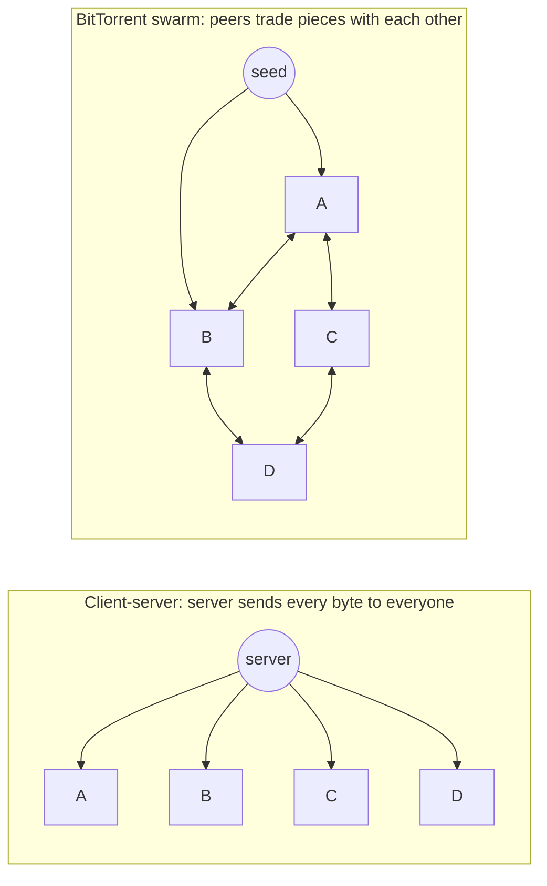
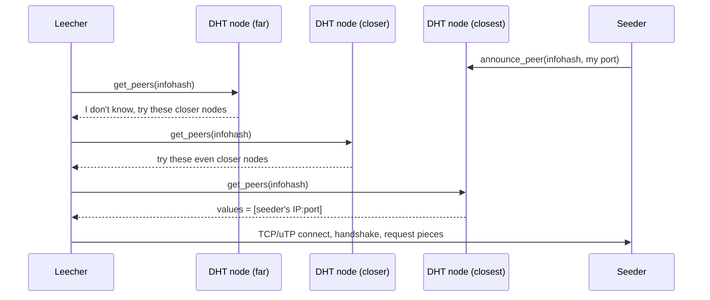

# libtorrent Playground

**Hands-on BitTorrent for the Trackerless-P2P-Network team.** Eight small Python experiments that run real BitTorrent swarms on your own laptop, so you can *see* the things our project is about: trackerless peer discovery, Kademlia lookups, a seeder dying mid-download, Merkle-tree security and P2P video streaming.

You don't need to know anything about torrents to start. Section 2 explains everything the experiments use, and every experiment prints what it's doing as it goes.

---

## Contents

1. [What is this?](#1-what-is-this)
2. [BitTorrent in 10 minutes (start here if torrents are new to you)](#2-bittorrent-in-10-minutes)
3. [What is libtorrent, and why play with it?](#3-what-is-libtorrent-and-why-play-with-it)
4. [Setup, step by step](#4-setup-step-by-step)
5. [How the playground works](#5-how-the-playground-works)
6. [The experiments](#6-the-experiments)
7. [What this means for our project](#7-what-this-means-for-our-project)
8. [Write your own experiment](#8-write-your-own-experiment)
9. [Troubleshooting](#9-troubleshooting)
10. [Glossary](#10-glossary)
11. [Further reading](#11-further-reading)

---

## 1. What is this?

Our project builds a **trackerless peer-to-peer network** from scratch in Go: a Kademlia DHT, peer discovery, piece transfer, Merkle-tree security, and maybe streaming. This folder does the opposite: it takes **[libtorrent](https://github.com/arvidn/libtorrent)**, the battle-tested C++ BitTorrent engine behind qBittorrent and Deluge, and drives it from Python to run our project's demos and evaluation graphs on **production BitTorrent**.

That gives us three things:

- **Intuition:** watch pieces fly, swarms stall, lookups converge and attackers get banned, before writing the Go version
- **A baseline:** reference numbers (lookup cost vs network size, recovery time, overhead) to compare our implementation against
- **Surprises:** several things here behave differently from what you'd guess, and they matter for our demo (see [section 7](#7-what-this-means-for-our-project))

Everything runs on `127.0.0.1` unless you explicitly ask for the Internet (experiments 04 and `05 --internet`). Nothing is downloaded from or shared with strangers.

---

## 2. BitTorrent in 10 minutes

### The problem: one server, many downloaders

When 100 people download a 1 GB file from one server, the server has to send **100 GB**. Its upload link is the bottleneck, so every new downloader makes everyone slower.

### The idea: everyone who downloads also uploads

BitTorrent cuts the file into **pieces** (typically 16 KiB – 4 MiB). As soon as you have a piece, you start **uploading it to others** while you download the rest. Every new downloader adds upload capacity, so the system gets *more* capable as it grows.



### The words you'll see everywhere

| word | meaning |
|---|---|
| **piece** | a fixed-size chunk of the file (the unit that gets hash-checked) |
| **block** | a 16 KiB slice of a piece (the unit actually requested over the wire) |
| **peer** | any computer taking part |
| **seeder / seed** | a peer that has the **whole** file and only uploads |
| **leecher** | a peer that's still downloading (and uploading what it already has) |
| **swarm** | all the peers sharing one file |

### The `.torrent` file: a description, not the data

A `.torrent` is a tiny file that describes the content: file names and sizes, the piece size, and a **cryptographic hash of every piece**. It's written in **bencoding**, a simple format with four types:

```
i42e            -> the integer 42
5:hello         -> the string "hello"  (length, colon, bytes)
l4:spami7ee     -> the list ["spam", 7]
d3:cow3:mooe    -> the dict {"cow": "moo"}
```

The hash of the torrent's `info` section is the **infohash**, a 20- or 32-byte ID that names the content. Two people with the same infohash are talking about exactly the same bytes.

### Trust: why a stranger can't send you garbage

Every piece you receive is hashed and compared with the hash in the `.torrent`. A wrong byte means a failed hash check, the piece is thrown away and re-downloaded, and the sender loses trust (eventually it's banned). You can download from completely untrusted peers and still end up with a perfect file.

- **v1 torrents** store one SHA-1 hash per piece. A failed piece tells you "something in these N KiB is wrong", but not which block or which peer.
- **v2 torrents** (BEP 52) store a **Merkle tree** per file: a hash for every 16 KiB block, combined pairwise up to a single **root**. A peer can prove any block belongs to the file with a few hashes, and a bad block can be pinpointed exactly. (Our project's security idea.)

### Finding peers: tracker vs trackerless

You have an infohash. Who else has the file?

- **Tracker (the classic way):** a central web server that keeps a list "infohash → peers". It's simple, but it's a central point of failure and control.
- **Trackerless (DHT, what our project builds):** every peer is also a node in a **Distributed Hash Table**. The "infohash → peers" list is spread across thousands of nodes using **Kademlia**:
  - every node has a random 160-bit **node ID**
  - the **distance** between two IDs is their XOR
  - the peers for an infohash are stored on the nodes whose IDs are **closest** to that infohash
  - to find them, you ask the closest nodes you know, they point you to even closer ones, and in **O(log N)** steps you reach the right nodes



The global BitTorrent DHT (the "Mainline DHT", BEP 5) has millions of nodes, and nobody owns it.

### Magnet links

`magnet:?xt=urn:btih:<infohash>` is just the infohash in a URL. With a magnet link you don't even need the `.torrent`: you find peers through the DHT and **download the `.torrent` metadata from them** (BEP 9).

### Two tricks that make swarms work

- **Rarest first:** download the piece the fewest peers have, so rare pieces get copied before their only owner leaves.
- **Tit-for-tat (choking):** upload mostly to the peers that upload to you, so freeloaders get less.

### BEPs

Every BitTorrent feature is specified in a numbered **BitTorrent Enhancement Proposal** at [bittorrent.org/beps](https://www.bittorrent.org/beps/bep_0000.html). The ones that matter most here:

| BEP | what it adds |
|---|---|
| 3 | the original protocol |
| 5 | the DHT (Kademlia): trackerless |
| 9 | magnet links: fetch the `.torrent` from peers |
| 16 | super-seeding |
| 29 | uTP: BitTorrent's own congestion-controlled transport over UDP |
| 44 | storing arbitrary data in the DHT (key-value store) |
| 52 | BitTorrent v2: SHA-256 Merkle trees |

---

## 3. What is libtorrent, and why play with it?

[libtorrent](https://github.com/arvidn/libtorrent) (by Arvid Norberg, BSD license) is a C++ BitTorrent library implementing the protocol plus almost every extension: v1 and v2 torrents, the DHT, magnet links, peer exchange, uTP, encryption, super-seeding and more (~34 BEPs). We use the **2.1 series** (branch `RC_2_1`) through its official **Python bindings** (`pip install libtorrent`).

In Python, one `lt.session` object is one complete BitTorrent client. That lets us start a whole swarm from a short script, rate-limit each peer like a home connection, kill peers on purpose, and read libtorrent's internal counters and events ("alerts") to measure everything.

---

## 4. Setup, step by step

### What you need

| thing | needed for | check with |
|---|---|---|
| **Python 3.9 – 3.13** (3.14 has no libtorrent wheel yet) | everything | `python3 --version` |
| Linux (x86_64/arm64), macOS 14+ or Windows | prebuilt libtorrent wheels exist for all of these (only Linux has been tried) | |
| ~1 GB free in `/tmp` | test files and downloads | `df -h /tmp` |
| `ffmpeg` | experiment 07 only | `ffmpeg -version` |
| VLC or `ffplay` | watching experiment 07 (optional) | `vlc --version` |
| Wireshark / `tcpdump` | packet capture extras (optional) | `wireshark --version` |

Tested on Ubuntu 22.04 with Python 3.10. Everything uses only Python's standard library plus `libtorrent` and `cryptography`.

### Install

From the root of the repository:

```bash
cd playground/libtorrent
```

**Option A, with [uv](https://docs.astral.sh/uv/) (fast):**

```bash
uv venv .venv --python 3.10
uv pip install --python .venv/bin/python -r requirements.txt
```

**Option B, with plain pip:**

```bash
python3 -m venv .venv
.venv/bin/pip install -r requirements.txt
```

On Windows, use `.venv\Scripts\python` wherever this README says `.venv/bin/python`.

`requirements.txt` installs:
- `libtorrent==2.1.1.0`: the wheel includes the compiled C++ library, so there's nothing to build
- `cryptography`: only used to make ed25519 keys in experiment 05

The `.venv/` folder is git-ignored, so every teammate creates their own.

### Check it works

```bash
.venv/bin/python -c "import libtorrent as lt; print(lt.__version__)"
```

This should print `2.1.1.0`. Then run the first experiment:

```bash
.venv/bin/python 00_anatomy.py
```

Every script has a `--help`:

```bash
.venv/bin/python 02_chaos_swarm.py --help
```

> **Tip:** run the experiments in a real terminal, not an IDE's output pane. They redraw progress bars in place, which needs a terminal that understands ANSI escape codes (any Linux/macOS terminal, Windows Terminal).

---

## 5. How the playground works

```
one Node  =  one libtorrent session  =  one BitTorrent client on 127.0.0.1:<port>
```

- A script starts several **Nodes** inside one Python process. To the protocol they're completely separate machines that happen to share an IP: separate sockets, threads, piece storage and DHT node.
- **Upload limits** make each node behave like a home connection, so a download takes seconds instead of milliseconds and there's something to watch.
- Most experiments build a **private DHT**: every node joins a Kademlia network made only of playground nodes. It never touches the Internet, and no firewall can block it.
- Test files, `.torrent`s and downloads go to **`/tmp/lt-playground/<experiment>/`** (wiped on reboot, recreated on every run). Set `LT_WORK=/some/other/dir` to put them elsewhere.
- **`lab.py`** holds the shared helpers (`Node`, `make_torrent`, `private_dht`, progress bars). It's short and commented; read it once.

### Ports used

| experiment | ports on 127.0.0.1 |
|---|---|
| 01 | 6881, 6882 |
| 02 | 7000 + one per leecher (with `--sweep`: 7020 and up, 20 per run) |
| 03 | 8000 and up, a block of 400 per network size |
| 05 | 9000 + one per node |
| 06 | 7400 and up, 20 per run |
| 07 | 7600–7603 and 7610, plus HTTP on **8888** |
| 04, 05 `--internet` | a random port on all interfaces (the only ones that talk to the Internet) |

Run one experiment at a time: some port ranges overlap.

---

## 6. The experiments

Do them **in order**: each builds on the previous one. Every swarm experiment ends by checking the downloaded file's MD5 against the original.

The "what we measured" numbers come from one laptop (Ubuntu 22.04, 20 cores) on 2026-11-12. Yours will differ a bit, but the shapes should be the same.

### 00: Anatomy of a torrent

**Teaches:** bencoding, the infohash, and v1 vs v2 vs hybrid torrents (what a Merkle root looks like in practice).

```bash
.venv/bin/python 00_anatomy.py
.venv/bin/python 00_anatomy.py --piece-kib 16     # smaller pieces, more hashes
```

It creates `meme-folder/` with `readme.txt`, `cat.gif` and `cat-copy.gif` (byte-identical), hashes it three ways, and prints each `.torrent` raw and decoded.

**Look for:**
- the raw bencoding (`d10:created by45:...`)
- **no `announce` key**: no tracker
- the v1 SHA-1 infohash (`urn:btih:`) vs the v2 SHA-256 one (`urn:btmh:1220...`)
- v1's single `pieces` string vs v2's `file tree` with a **`pieces root`** (Merkle root) per file
- **`cat.gif` and `cat-copy.gif` have the same root**, and `piece layers` has a single entry: identical files are recognisable across torrents
- hybrid torrents add `.pad` files (BEP 47) so every file starts on a piece boundary

Then poke at the raw bytes yourself:

```bash
xxd /tmp/lt-playground/00-anatomy/meme-folder.v1.torrent | head
```

### 01: First swarm

**Teaches:** a seeder and a leecher, piece-by-piece download, hash verification, and the wire protocol in Wireshark.

```bash
.venv/bin/python 01_first_swarm.py                       # 64 MiB, as fast as possible
.venv/bin/python 01_first_swarm.py --rate 0.5            # seeder capped at 0.5 MB/s: watchable
.venv/bin/python 01_first_swarm.py --size-mb 8 --encrypt # protocol encryption on
```

| flag | default | meaning |
|---|---|---|
| `--size-mb` | 64 | size of the random payload |
| `--rate` | 0 | seeder upload cap in MB/s (0 = unlimited) |
| `--encrypt` | off | turn on Message Stream Encryption |

What happens:
1. It makes `bt-hello/` (a random `payload.bin` + an ASCII-art `hello.txt`) and a hybrid `.torrent`.
2. It starts the seeder on port 6881 and the leecher on 6882 (TCP only, unencrypted by default, so Wireshark can read everything).
3. It introduces them by hand with `connect_peer`, the job a tracker or the DHT normally does.
4. A live progress bar and a **piece map** show pieces arriving in random order (rarest-first).
5. It prints the MD5 of both copies, `hello.txt` read from the **leecher's** disk, and bytes on the wire vs payload.

**What we measured:** 64 MiB in 1.3 s over loopback, MD5 identical, **2.9% overhead** (protocol messages + TCP/IP headers).

**Watch the wire (optional, needs sudo):**

```bash
sudo tcpdump -i lo -w /tmp/bt.pcap 'tcp port 6881'      # terminal 1 (macOS: -i lo0)
.venv/bin/python 01_first_swarm.py --rate 0.5 --size-mb 8   # terminal 2
wireshark /tmp/bt.pcap                                   # after stopping tcpdump with Ctrl+C
```

Use the display filter `bittorrent` and find:
- the **handshake** (`\x13BitTorrent protocol` + 8 reserved bytes + infohash + peer ID starting with `-LT21`)
- the **extended handshake** (a bencoded dict of supported extensions)
- `bitfield`, `interested`, `unchoke`, then `request` (index, begin, length 16384) → `piece`
- `have` messages flowing back

Every message is `<4-byte length><1-byte type><payload>`: length-prefixed framing, the same idea as our Go code's `docs/03-message-framing.md`. Capture again with `--encrypt` and it all turns into noise.

### 02: Chaos swarm (the project demo)

**Teaches:** trackerless discovery through a DHT, what happens when the seeder dies, super-seeding, protocol overhead, and why P2P beats client-server.

How the swarm is built:
1. **1 seed + 5 leechers** on ports 7000–7005. Uploads are capped: seed 2 MB/s, each leecher 1 MB/s.
2. **The DHT comes first:** every node joins a private DHT through node 0, like a new Kademlia node bootstrapping from one known contact.
3. The seed adds a 32 MiB file and **announces** its infohash to the DHT.
4. Leechers know **only the infohash**. They ask the DHT `get_peers`, connect to whoever answers, and trade pieces.
5. **Chaos:** at 40% average progress, the seed is destroyed.

```bash
.venv/bin/python 02_chaos_swarm.py                                     # kill the seed at 40%
.venv/bin/python 02_chaos_swarm.py --kill-at 0.1                        # kill it really early
.venv/bin/python 02_chaos_swarm.py --kill-when-complete                 # kill at the earliest "safe" moment
.venv/bin/python 02_chaos_swarm.py --kill-when-complete --super-seed    # BEP 16 super-seeding
.venv/bin/python 02_chaos_swarm.py --kill-at -1                         # never kill: baseline
.venv/bin/python 02_chaos_swarm.py --sweep 1,2,4,8                      # P2P vs client-server
```

| flag | default | meaning |
|---|---|---|
| `--leechers` | 5 | number of leechers |
| `--size-mb` | 32 (8 for `--sweep`) | file size |
| `--piece-kib` | 64 | piece size |
| `--seed-up` / `--peer-up` | 2.0 / 1.0 | upload caps in MB/s |
| `--kill-at` | 0.4 | kill the seed at this average progress; `-1` = never |
| `--kill-when-complete` | off | kill the seed as soon as every piece exists on some leecher |
| `--super-seed` | off | the seed hands each piece out only once (BEP 16) |
| `--direct` | off | skip the DHT, wire peers together by hand |
| `--sweep N,N,...` | off | measure download time vs number of leechers |

The key line on screen is **"pieces that exist on some leecher"**: the swarm's collective copy *without* the seed.

**What we measured (32 MiB, 5 leechers):**

| run | seed killed at | pieces alive on leechers at that moment | outcome |
|---|---|---|---|
| `--kill-at 0.4` | 13 s, 41% average progress | **53.3%** | **stalled forever at 53.3%**: 239 pieces existed only on the seed |
| `--kill-when-complete` | 31.5 s, **99%** average progress | 100% | everyone finished, MD5 OK |
| `--kill-when-complete --super-seed` | 28.3 s, **69%** average progress | 100% | everyone finished, MD5 OK (slower start) |

- **Killing the only seed at 40% stalls the swarm.** No DHT lookup can find a piece nobody has. A swarm survives the seed's death only once **every piece exists at least once among the leechers**.
- Why only 53%? All leechers see the same "rarest" pieces and ask the seed for the *same* ones, so the seed uploads duplicates. **Super-seeding** fixes that: a full copy existed at 69% progress instead of 99%.
- **Time to recovery** (seed killed → next byte of progress): ~0.9 s. The leechers already knew each other from the DHT.
- **Control vs payload** (every byte every node sent): payload ~94%, TCP/IP headers ~5.7%, BitTorrent messages ~0.25%, DHT ~0.1%. **Control overhead ≈ 6%.**

**P2P vs client-server (`--sweep`):** each N runs twice. "client-server" = leechers refuse to upload, so only the seed sends; "P2P" = normal BitTorrent. Measured times are printed next to the theory from Kurose & Ross (§2.5), with *F* = file size, *u_s* = server upload, *u* = peer upload:

```
D_client-server = N·F / u_s
D_p2p           = max( F / u_s ,  N·F / (u_s + N·u) )
```

| N leechers | client-server | P2P |
|---|---|---|
| 1 | 7.0 s | 7.0 s |
| 2 | 11.1 s | 9.1 s |
| 4 | 18.6 s | 11.1 s |
| 8 | **34.0 s** | **13.6 s** |

(8 MiB file. This first run timed from the very start, including ~3 s of connection setup; the script now starts the clock at the first payload byte, and client-server then matches theory almost exactly.) Client-server grows **linearly**; P2P barely moves, because every leecher brings upload capacity.

### 03: DHT scaling

**Teaches:** Kademlia lookups cost **O(log N)** messages. This is our project's first evaluation graph, drawn with libtorrent's production DHT as a reference curve.

```bash
.venv/bin/python 03_dht_scaling.py                            # N = 5,10,20,50,100
.venv/bin/python 03_dht_scaling.py --sizes 10,40,160 --lookups 20
```

For each network size N:
1. Start N DHT-only nodes on localhost.
2. **Join** the way the Kademlia paper (§2.3) describes: each node knows one random existing node, then every node does a few lookups for random IDs (a "bucket refresh").
3. A few nodes announce random infohashes.
4. Run lookups from random nodes, counting the `get_peers` messages each needs before it finds a peer.

**What we measured:**

| N | log₂ N | messages per lookup |
|---|---|---|
| 5 | 2.3 | 3.3 |
| 10 | 3.3 | 4.2 |
| 20 | 4.3 | 4.7 |
| 50 | 5.6 | 5.0 |
| 100 | 6.6 | 5.4 |

N grew **20×**, lookup cost grew **1.6×**. Asking random nodes would need about N/2.

**Two traps we hit, both relevant to our Go code:**
- **A join without a refresh is broken.** When each node only pinged its single contact, 20 nodes ended up knowing just 1–2 others each. The paper's bucket refresh fixed it (~19 each). Our Go README lists "no post-join bucket refresh" as a simplification, so we should check our routing tables.
- **100 nodes on one IP looks like a DoS attack.** libtorrent's DHT bans any IP sending more than 5 packets/s for 5 minutes, and all our nodes share 127.0.0.1. `lab.py` raises that limit. Our Go node has no such protection at all.

**See the DHT packets:**

```bash
sudo tcpdump -i lo -w /tmp/dht.pcap 'udp portrange 8000-8099'   # terminal 1
.venv/bin/python 03_dht_scaling.py --sizes 20 --lookups 3        # terminal 2
wireshark /tmp/dht.pcap
```

In Wireshark: right-click a packet → **Decode As… → BT-DHT**. You'll see KRPC messages: bencoded dicts like `{q: get_peers, a: {id, info_hash}}`, and replies with `nodes` (26 bytes per contact: 20-byte ID + IPv4 + port) or `values` (peers).

### 04: Internet DHT explorer

**Teaches:** what the real Mainline DHT looks like: millions of nodes, your k-buckets filling, BEP 42 (your node ID is derived from your public IP), and real lookup times.

```bash
.venv/bin/python 04_dht_internet.py
.venv/bin/python 04_dht_internet.py --warmup 120
.venv/bin/python 04_dht_internet.py --lookup <40-hex-char infohash>
```

| flag | default | meaning |
|---|---|---|
| `--warmup` | 45 | seconds to let your routing table grow |
| `--port` | 0 (random) | UDP/TCP port to use |
| `--lookup` | | extra infohash to look up (repeatable) |

It joins as a **plain DHT node only**: no torrents, nothing downloaded or shared, and router port-mapping (UPnP/NAT-PMP) is off. It draws your routing table bucket by bucket, estimates the network size from its depth (N ≈ k · 2^(depth−1), with libtorrent's k = 8), then times lookups for two Creative Commons films (Sintel and Big Buck Bunny) and for a random ID nobody has.

> **⚠ Campus Wi-Fi blocks this one.** On our college network, DHT bootstrap routers never answer even though ordinary UDP (DNS) works. Use a **phone hotspot or home Wi-Fi**. The script detects the block after 25 s and tells you. Its lookup code is the same as experiment 03's, but its Internet path has not been tested yet: if you run it, tell the team what you see.

### 05: DHT post-it notes

**Teaches:** the DHT as a **key-value store** (BEP 44). This is the `STORE` / `FIND_VALUE` step our Go Kademlia lists as "what's next", plus why signatures matter.

```bash
.venv/bin/python 05_dht_postit.py                                 # private 30-node DHT
.venv/bin/python 05_dht_postit.py --nodes 100 --message "hi team"
.venv/bin/python 05_dht_postit.py --internet                      # the REAL DHT: public! hotspot only
```

Characters: **alice** writes, **bob** (another node far away in ID space) reads, **mallory** attacks.

1. **Immutable item ("message in a bottle"):**
   - Alice stores a string under the key **SHA-1(bencoded value)**; the script recomputes it with Python's `hashlib` to prove it.
   - libtorrent stores it on the k = 8 nodes closest to that key.
   - Bob, knowing only the 20-byte key, gets the message back.
2. **Mutable item ("status board"):**
   - Alice makes an ed25519 keypair and posts two versions, each with a higher sequence number and her signature.
   - Bob reads by her public key and gets the newest.
3. **Forgery:** Mallory posts to Alice's public key, signed with her own key.

**What we measured:** stored on 8 nodes, read back instantly; the mutable item went seq 1 → 2; Mallory's forgery was accepted by **0 nodes**.

> With `--internet`, what you post is **public** and stays for about 2 hours. Don't post anything personal.

### 06: Evil seeder (Merkle-tree security)

**Teaches:** how hash checks catch a lying peer, the difference between v1 (one hash per piece) and v2 (Merkle tree per 16 KiB block), and how hard it is to blame the *right* peer.

Setup:
- **3 honest seeders + 1 evil seeder**, all at the same speed.
- The evil one passes its own hash check at startup; then the script **flips one byte inside every piece** of its file on disk.
- The leecher is told never to fetch a whole piece from one peer (`whole_pieces_threshold = 0`), so pieces are built from blocks of several seeders, as in a big real swarm.

It runs 4 configurations, several times each:

| | v1 torrent | v2 torrent |
|---|---|---|
| **naive** (no parole mode, no smart-ban plugin) | ✓ | ✓ |
| **libtorrent defaults** (parole mode + smart-ban) | ✓ | ✓ |

```bash
.venv/bin/python 06_evil_seeder.py                    # 3 trials each, ~2 minutes
.venv/bin/python 06_evil_seeder.py --trials 10        # better statistics
.venv/bin/python 06_evil_seeder.py --piece-kib 4096 --honest 6
```

| flag | default | meaning |
|---|---|---|
| `--size-mb` | 16 | file size |
| `--piece-kib` | 1024 | piece size (bigger = more waste per failure in v1) |
| `--rate` | 1.0 | each seeder's upload cap, MB/s |
| `--honest` | 3 | number of honest seeders |
| `--trials` | 3 | runs per configuration |

**How libtorrent decides who lied** (from its source, `torrent.cpp`):
- a peer that sent **every** block of a failed piece is banned immediately
- otherwise **every peer that contributed** (honest ones too!) loses 2 trust points, and is banned at −7; good pieces earn trust back
- **v2** additionally fetches the block-level Merkle hashes of the failed piece, so it can blame only the sender of the bad block
- **parole mode:** a suspect must then download whole pieces alone, so its next failure has a single author
- **smart-ban:** remember a checksum of every block and who sent it, and compare after re-downloading

**What we measured (3 trials, 16 MiB, 1 MiB pieces):**

| config | hash failures (avg) | data thrown away | evil banned | honest banned (avg) | file OK |
|---|---|---|---|---|---|
| v1 naive | 5.0 | 5.0 MiB | 2 of 3 runs | 0.3 | 3 of 3 |
| v2 naive | 4.0 | 4.0 MiB | 2 of 3 runs | 0.3 | 3 of 3 |
| v1 + defences | **1.7** | 1.7 MiB | **3 of 3 runs** | 0 | 3 of 3 |
| v2 + defences | 4.3 | 4.3 MiB | **0 of 3 runs** | 0 | 3 of 3 |

- **The downloaded file was never corrupted.** Hashes always catch the poison; the open questions are how much data gets wasted and who gets blamed.
- **Innocent seeders do get banned sometimes.** Piece-level blame punishes everyone who contributed to a failed piece; one earlier run banned 2 of the 3 honest seeders.
- **Results swing a lot between runs**, which is why the script repeats them. Our project's evaluation should repeat every scenario too.
- **Open question:** v2 + defences *never* banned the attacker in our runs, while v1 + defences always did. We expected the opposite. Finding out why (smart-ban, `verify_block_hashes`, the hash picker in the libtorrent source) is a great Merkle-tree task.

### 07: P2P video streaming

**Teaches:** how to stream a video out of a swarm while it's still downloading: sequential download, piece deadlines, and a player reading through an HTTP server. This is the "Node 5 plays a video while downloading from Nodes 2, 3 and 4" demo from our project idea.

```bash
.venv/bin/python 07_stream_video.py                      # opens VLC automatically
.venv/bin/python 07_stream_video.py --chaos              # kill seeder 2 a third of the way in
.venv/bin/python 07_stream_video.py --seed-rate 0.08     # swarm slower than the video: it stalls
.venv/bin/python 07_stream_video.py --player ffplay
.venv/bin/python 07_stream_video.py --player none        # then open the URL in any player
```

| flag | default | meaning |
|---|---|---|
| `--seconds` | 60 | length of the generated test movie |
| `--seed-rate` | 0.15 | each seeder's upload cap, MB/s |
| `--chaos` | off | kill seeder 2 at 33% downloaded |
| `--player` | `vlc` | `vlc`, `ffplay` or `none` |

How it works:
1. **ffmpeg** generates a 60 s, 720p test movie with a big on-screen clock (14.9 MiB; it needs **0.25 MB/s** to play in real time).
2. **3 seeders** each upload at most 0.15 MB/s. None can keep up alone; together they give 0.45 MB/s.
3. The leecher downloads in **streaming mode**: `sequential_download` (pieces in order) plus `set_piece_deadline` on the 12 pieces just ahead of the playhead, so libtorrent races for those first.
4. A tiny **HTTP server** on `http://127.0.0.1:8888/video.mp4` serves the file to the player. Each read **waits until the pieces underneath have arrived and passed their hash check**. That's how streaming torrent clients like peerflix and WebTorrent work.
5. The piece map shows `▶` (where the player is reading) moving through the pieces.

**What we measured:** with a real-time `ffmpeg` player and `--chaos`, the 60 s movie played in 65 s of wall-clock time with no errors, **even though seeder 2 died at 14 s** (the two survivors' 0.30 MB/s still beats the 0.25 MB/s bitrate). The full file was MD5-verified at the end.

**Try:** `--chaos --seed-rate 0.1` (2 × 0.1 < 0.25, so the video *must* stall), or drag VLC's seek bar: the player sends a new HTTP `Range:` request and the deadlines jump to the new spot.

---

## 7. What this means for our project

Things we learned that feed straight into our Go implementation, our evaluation and our demo:

### For the demo
- **"Kill the seeder at 40%" will stall** unless every piece already exists on some other peer. Options:
  - kill it only once the swarm holds a complete copy (show that number on the dashboard!)
  - make the seeder super-seed, i.e. hand out each piece once
  - make "this is why the swarm stalled" part of the demo
- **Streaming needs three ingredients:** pieces in order near the playhead, deadlines (urgent pieces requested first, from several peers), and a reader that blocks until a piece is verified (experiment 07).
- **Show the MD5 at the end.** Every experiment here does, and it's very convincing.

### For the Go implementation
- **Do the bucket refresh after joining** (Kademlia paper §2.3). Without it, libtorrent nodes knew almost nobody (experiment 03).
- **Announce after you have contacts.** An announce into an empty routing table reaches nobody (it froze experiment 02 until the order was fixed).
- **`STORE` / `FIND_VALUE`:** experiment 05 shows the intended behaviour: store on the k closest nodes, stop the lookup as soon as someone returns the value. Signatures and sequence numbers are how BEP 44 stops overwrites.
- **Rate-limit per IP.** Real DHT nodes ban IPs that flood them (5 packets/s in libtorrent), which is basic DoS resistance and an easy security feature.
- **Integrity:** hash every piece; if we do Merkle trees, use per-block hashes to blame the exact sender (experiment 06).

### For the evaluation
| metric from our project plan | reference here |
|---|---|
| lookup latency vs network size, O(log N) | experiment 03: 3.3 → 5.4 messages for 5 → 100 nodes |
| download time vs number of leechers, centralized vs P2P | experiment 02 `--sweep`, with Kurose's formulas |
| time to recovery after the seeder dies | experiment 02: ~0.9 s when peers already know each other |
| control bytes vs payload bytes | experiments 01 and 02: ~3–6% overhead |
| security under attack | experiment 06 (run several trials!) |

---

## 8. Write your own experiment

The helpers in `lab.py` make a new experiment about 20 lines long:

```python
import time
import libtorrent as lt
import lab

w = lab.workdir("my-experiment")                         # fresh /tmp/lt-playground/my-experiment
data = lab.make_file(w / "seed" / "file.bin", 16 * lab.MiB)
ti = lab.make_torrent(data, piece_size=256 * lab.KiB, flavor="hybrid")   # or "v1" / "v2"

seed = lab.Node("seed", 7900, dht=True, up_limit=1 * lab.MiB)   # 1 MB/s upload cap
peer = lab.Node("peer", 7901, dht=True)
peer.bootstrap_dht(seed)                                 # join the private DHT through the seed
seed.add(ti, w / "seed")
peer.add(ti, w / "peer")                                 # only knows the infohash: finds the seed via the DHT

while not peer.status().is_seeding:
    s = peer.status()
    print(f"{s.progress:6.1%}  {lab.rate(s.download_payload_rate)}  peers={s.num_peers}")
    time.sleep(1)
print("md5 match:", lab.md5(data) == lab.md5(w / "peer" / data.name))
print("bytes sent by seed:", seed.counters()["net.sent_bytes"])
```

Useful pieces:

| helper | what it does |
|---|---|
| `lab.Node(name, port, dht=, up_limit=, down_limit=, tcp_only=, encrypt=, plugins=, extra={...})` | one BitTorrent client; `extra` takes any [libtorrent setting](https://www.libtorrent.org/reference-Settings.html) |
| `node.add(ti, path, flags=...)` | start a torrent (e.g. `lt.torrent_flags.seed_mode`, `super_seeding`, `sequential_download`) |
| `node.connect(other)` / `node.bootstrap_dht(other)` | introduce peers by hand / join the DHT |
| `node.kill()` | destroy the client (sockets close, DHT node vanishes) |
| `node.counters()` | libtorrent's session counters (bytes sent/received, DHT bytes, ...) |
| `node.pop_alerts()` | libtorrent's event stream (peer connected, hash failed, peer banned, ...) |
| `lab.private_dht(n, base_port)` | n DHT-only nodes, joined and refreshed |
| `lab.bar`, `lab.piece_map`, `lab.sparkline`, `lab.Screen` | terminal drawing |

Ideas: churn (peers randomly joining and leaving), a "free-rider" peer that never uploads (does tit-for-tat punish it?), uTP vs TCP on a congested link, piece size vs speed.

---

## 9. Troubleshooting

| problem | fix |
|---|---|
| `ModuleNotFoundError: No module named 'libtorrent'` | you're not using the venv's Python: run `.venv/bin/python ...` from this folder |
| `pip` can't find a libtorrent version | your Python is too new or too old: use 3.9–3.13 (`uv venv .venv --python 3.12`) |
| a swarm sits at 0% | another experiment is still running on the same ports: stop it (`pkill -f '0[0-7]_[a-z_]*\.py'`) and retry |
| experiment 04 says "no DHT node answered" | the network blocks BitTorrent DHT; use a phone hotspot |
| 07: `ffmpeg: not found` | install ffmpeg (`sudo apt install ffmpeg` / `brew install ffmpeg`) |
| 07: no video window | VLC isn't on your `PATH` (common on macOS): use `--player ffplay`, or `--player none` and open `http://127.0.0.1:8888/video.mp4` in VLC (Media → Open Network Stream) |
| progress bars print hundreds of lines | you're not in a real terminal (IDE output pane, pipe); output is still correct |
| `/tmp` fills up | `rm -rf /tmp/lt-playground` (everything there is regenerated) |
| numbers differ from this README | expected: they depend on your CPU and on randomness. Look at the shapes, and repeat runs |

---

## 10. Glossary

| term | meaning |
|---|---|
| **announce** | tell a tracker or the DHT "I have (or want) this infohash; here's my port" |
| **bencoding** | BitTorrent's serialization format (`i`, `l`, `d`, `<len>:` strings) |
| **BEP** | BitTorrent Enhancement Proposal, a numbered spec |
| **block** | 16 KiB slice of a piece; the unit you request from a peer |
| **bootstrap** | joining a DHT by contacting one known node |
| **choke / unchoke** | refuse / allow uploading to a peer |
| **DHT** | Distributed Hash Table: a key-value store spread across all nodes |
| **hybrid torrent** | a torrent with both v1 and v2 metadata |
| **infohash** | hash of the torrent's `info` dict; the content's ID |
| **k-bucket** | a list of up to k known nodes at a given XOR distance range |
| **Kademlia** | the DHT algorithm BitTorrent uses: XOR distance, k-buckets, iterative lookups |
| **KRPC** | the DHT's tiny RPC protocol: bencoded messages over UDP |
| **leecher** | a peer that hasn't finished downloading |
| **magnet link** | a URL containing just the infohash |
| **Merkle tree** | a tree of hashes; the root commits to every leaf, so one leaf can be proven with a few hashes |
| **node ID** | a peer's 160-bit DHT identity |
| **PEX** | Peer Exchange: peers telling each other about other peers |
| **piece** | a fixed-size chunk of the content, hash-checked as a unit |
| **rarest first** | download the pieces fewest peers have first |
| **seeder** | a peer with the complete file |
| **super-seeding** | a seed hands each piece out once, to spread the file faster |
| **swarm** | all peers sharing one torrent |
| **tracker** | a central server that lists peers per infohash |
| **uTP** | BitTorrent's UDP transport with delay-based congestion control (LEDBAT) |
| **XOR distance** | distance between two IDs = their bitwise XOR, read as a number |

---

## 11. Further reading

- **The original paper:** Maymounkov & Mazières, *Kademlia: A Peer-to-peer Information System Based on the XOR Metric* (PDF in the repository root)
- **BEP index:** https://www.bittorrent.org/beps/bep_0000.html. Start with BEP 3 (protocol), 5 (DHT), 52 (v2)
- **libtorrent** source (branch `RC_2_1`): https://github.com/arvidn/libtorrent/tree/RC_2_1 and docs: https://www.libtorrent.org/reference.html
- **Unofficial spec, very readable:** https://wiki.theory.org/BitTorrentSpecification
- **Kurose & Ross**, *Computer Networking: A Top-Down Approach*, §2.5 (P2P file distribution: the formulas in experiment 02)
- **Our Go implementation:** `docs/` in the repository root, read in order
